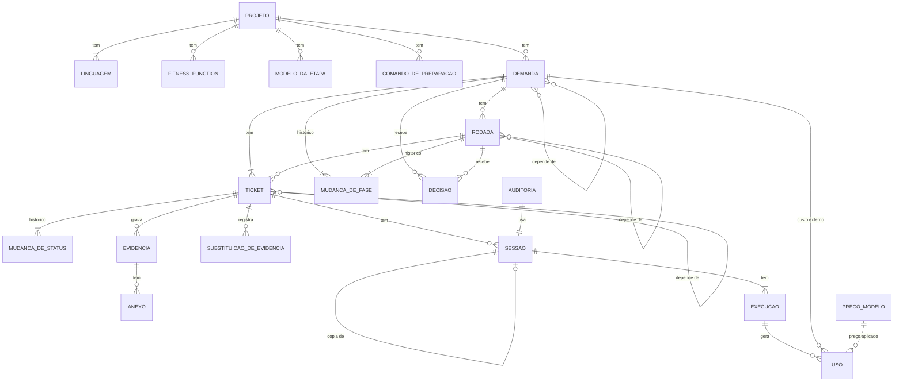

# Design — Entidades de domínio

Este documento fixa as entidades, os valores e as máquinas de estado da crate `dominio` (ver `01-pacotes.md`).
Os serviços, as interfaces e as sequências vêm nos documentos seguintes.

## Decisões

| # | Decisão | Motivo |
|---|---|---|
| D1 | Fase, status e estado são `enum` do Rust. Cada transição é uma função do domínio que devolve a mudança ou o erro da regra. | O compilador obriga a tratar cada fase. A regra fica num lugar só e se testa sem IO. |
| D2 | Demanda, rodada e ticket guardam o histórico de cada mudança de fase ou status, com data, autor e motivo. A fase atual é a última mudança. | O Auditor avalia o processo: desperdício, falha, retrabalho e tempo parado em cada fase. Sem um campo de fase separado, o histórico e a fase atual não divergem. |
| D3 | `cancelada` e `arquivada` são fases da demanda. | A fase de onde a demanda saiu fica no histórico (UC-DEM-02, UC-DEM-03, UC-DEM-04). |
| D4 | `I-n` é global. `R-n` e `T-n` contam por demanda. | Casa com `[I-n/R-n]`, `[I-n/T-m]` e `fabriquinha/I-n-R-n`. O CLI do agente acha a demanda pela execução em curso. |
| D5 | Métrica não é entidade. Os serviços a calculam a partir das entidades. | Toda métrica dos casos deriva de uso, decisão, ticket, evidência ou git. |
| D6 | O custo é gravado no `Uso`, no momento em que o uso chega. | Trocar o preço não reescreve o passado. |
| D7 | O preço por modelo vem de `precos.json`, versionado no repositório e embutido no binário. | Escolha do Auditor. |
| D8 | Dinheiro é inteiro em micro-dólares. | Soma sem erro de ponto flutuante. |
| D9 | Os dados de cada tipo de evidência são um `enum` com um formato por tipo. O JSON Schema sai desse tipo. | O schema que o agente recebe e a validação nunca divergem. |
| D10 | Critério de aceite é um valor dentro da evidência `criterios_aceite`, não uma entidade. | Ele só existe como parte do registro da demanda. A rodada cita o `CA-n`. |
| D11 | A evidência substituída some, com os anexos. Fica só o registro de que foi substituída, com a execução que a produziu e o tamanho dos anexos. | Mede o retrabalho sem guardar o disco das tentativas. O custo vem do `Uso` daquela execução. |

## Diagrama

## Agregados

O agregado é a fronteira de consistência: o que muda junto, numa transação, com as regras conferidas pelo domínio.

| Agregado | Contém | Por quê |
|---|---|---|
| Agendador | só ele | Configuração única do serviço. |
| Projeto | linguagens, fitness functions, modelos por etapa, preparação | O formulário grava tudo junto (UC-CFG-02, UC-CFG-03). |
| Demanda | rodadas, tickets, dependências, históricos, decisões | Gate, árvore, elegibilidade e cancelamento conferem rodadas e tickets juntos. |
| Sessão | execuções | O estado da sessão sai das execuções dela. |
| Evidência | anexos, substituições | Grande e gravada por ticket, fora da transação do gate. |
| Uso | só ele | Só acrescenta. |
| Auditoria | só ela | Fora de demanda e de ticket (UC-AUD-01). |

O cancelamento em cascata (UC-DEM-02, UC-DEM-03) atravessa demandas.
O domínio recebe o grafo de dependências e devolve as demandas a cancelar; o serviço grava tudo numa transação.

## Valores

| Valor | Forma | Regra |
|---|---|---|
| `DemandaId` | `I-n` | Inteiro positivo, global, sequencial. |
| `RodadaNum` | `R-n` | Inteiro positivo, sequencial dentro da demanda. |
| `TicketNum` | `T-n` | Inteiro positivo, sequencial dentro da demanda. |
| `CriterioId` | `CA-n` | Único dentro da demanda. |
| `Slug` | texto | Letra ou número, depois minúsculas, números e hífen, até 64 caracteres. |
| `Titulo` | texto | Uma linha, de 1 a 120 caracteres. |
| `Glob` | texto | Caminho a partir da raiz do repositório, com glob. |
| `Modelo` | provedor + modelo | O par precisa existir na lista do harness (UC-CFG-02). |
| `Effort` | enum | `off`, `minimal`, `low`, `medium`, `high`, `xhigh`, `max`. |
| `Hospedagem` | enum | `GitHub { dono, repo }` ou `AzureDevOps { org, projeto, repo }`, lida da URL do `origin`. |
| `Linguagem` | enum | Rust, TypeScript, JavaScript, Java, Kotlin, Python, Go, C#, Ruby, PHP, Swift, C, C++. |
| `Dolares` | inteiro | Micro-dólares (D8). |
| `Instante` | data e hora | Com fuso. O mês das métricas é o do fuso do serviço (UC-MET-01). |
| `Ator` | enum | `Auditor`, `IaExterna`, `Agente(ExecucaoId)`, `Fabriquinha`. |
| `CriterioAceite` | `{ id, dado, quando, entao }` | Valor dentro da evidência `criterios_aceite`. |

## Entidades

### Agendador

Única.
Nasce na primeira subida com os padrões (UC-CFG-01).

| Campo | Tipo | Regra |
|---|---|---|
| `ativo` | bool | Padrão desligado. |
| `intervalo` | minutos | 1 a 1440. Padrão 5. |
| `tempo_limite` | minutos | 10 a 1440. Padrão 120. Conta só o tempo ativo. |
| `ociosidade` | minutos | 5 a 1440. Padrão 30. |

### Projeto

| Campo | Tipo | Regra |
|---|---|---|
| `nome` | `Slug` | Chave. Não muda. |
| `branch_base` | texto | Existe no `origin`. |
| `chave_sonar` | texto | Obrigatória. |
| `raiz_git` | caminho | Derivada dos caminhos das linguagens. |
| `hospedagem` | `Hospedagem` | Derivada do `origin`. |
| `ultima_varredura` | `Instante` opcional | Varredura diária da branch base (UC-EXE-01). |
| `cursor_commits` | hash opcional | Último commit humano já contado (UC-CFG-02). |

**Linguagem** (1 projeto : N, ao menos uma).
`linguagem`, `caminho` absoluto e `comando_teste`.
A mesma linguagem pode repetir com outro caminho.

**FitnessFunction** (1 projeto : N, pode ser zero).
`nome` (`Slug`, único no projeto), `comando` e `descricao` (até 300 caracteres).

**ModeloDaEtapa** (1 projeto : N, no máximo uma por etapa).
`etapa`, `modelo` opcional e `effort` opcional.
Etapa sem linha usa o padrão do harness.
Só as etapas com agente entram: planejar, implementar, revisar a rodada, encerrar a rodada, sessão em aberto, revisar a demanda e resolver conflito.

**ComandoDePreparacao** (1 projeto : N, pode ser zero).
`ordem` e `comando`.
Roda na ordem ao criar a worktree.

### Demanda

| Campo | Tipo | Regra |
|---|---|---|
| `id` | `DemandaId` | `I-n`. |
| `projeto` | `Slug` | |
| `titulo` | `Titulo` | Congela no envio. |
| `tipo` | enum | `funcionalidade` ou `problema`. Congela no envio. |
| `descricao` | Markdown | Até 1.000 palavras. Congela no envio. |
| `dependencias` | lista de `DemandaId` | Ordenada, sem repetição, sem ciclo, sem autorreferência. Qualquer projeto. Muda até o planejamento ser aprovado. |
| `origem` | ferramenta + sessão | `pi`, `claude-code` ou `codex`, e o identificador da sessão do harness. Só ela edita até o envio. |
| `historico` | lista de `MudancaDeFase` | A fase atual é a última. |

**Fases**

| Fase | Gate |
|---|---|
| `demanda` | |
| `aprovacao_demanda` | Auditor |
| `planejamento` | |
| `aprovacao_planejamento` | Auditor |
| `execucao` | |
| `revisao_demanda` | |
| `encerramento_demanda` | |
| `concluida` | |
| `arquivada` | |
| `cancelada` | |

| De | Para | Quando | Caso |
|---|---|---|---|
| — | `demanda` | Registro pela IA externa | UC-DEM-01 |
| `demanda` | `aprovacao_demanda` | Envio com as três evidências aprovadas | UC-DEM-01 |
| `aprovacao_demanda` | `planejamento` | Auditor aprova | UC-DEM-02 |
| `planejamento` | `aprovacao_planejamento` | Agente envia a árvore | UC-PLAN-01 |
| `aprovacao_planejamento` | `execucao` | Auditor aprova | UC-PLAN-02 |
| `aprovacao_planejamento` | `planejamento` | Auditor reprova | UC-PLAN-02 |
| `execucao` | `revisao_demanda` | Última rodada concluída | UC-ENC-02 |
| `revisao_demanda` | `encerramento_demanda` | Agente aprova | UC-REV-02 |
| `revisao_demanda` | `execucao` | Agente reprova e cria rodada de correção | UC-REV-02 |
| `encerramento_demanda` | `concluida` | Merge feito e limpeza vazia | UC-ENC-03 |
| `concluida` | `arquivada` | Auditor arquiva | UC-DEM-04 |
| qualquer fase fora de `concluida`, `arquivada` e `cancelada` | `cancelada` | Recusa no gate, cancelamento ou cascata | UC-DEM-02, UC-DEM-03 |

`concluida`, `arquivada` e `cancelada` ficam fora do andamento e do agendador (UC-EXE-01).

### Rodada

| Campo | Tipo | Regra |
|---|---|---|
| `numero` | `RodadaNum` | `R-n` da demanda. |
| `titulo` | `Titulo` | |
| `criterios` | lista de `CriterioId` | Na árvore do planejamento, cada critério da demanda está em exatamente uma rodada. A rodada de correção cita critérios já existentes. |
| `dependencias` | lista de `RodadaNum` | Mesma demanda, sem ciclo. |
| `correcao` | bool | Nasce de uma revisão da demanda reprovada (UC-REV-02). |
| `criada_por` | `Ator` | Só quem criou edita ou remove, e só antes de a rodada começar. |
| `historico` | lista de `MudancaDeFase` | A fase atual é a última. |

Os caminhos da rodada não são campo: são a união dos caminhos dos tickets dela (UC-PLAN-02).
A rodada começa quando o primeiro ticket dela entra em execução.

**Fases**

| De | Para | Quando | Caso |
|---|---|---|---|
| — | `desenvolvimento` | Planejamento aprovado, ou rodada de correção criada | UC-PLAN-02, UC-REV-02 |
| `desenvolvimento` | `revisao` | Último ticket de implementação concluído | UC-IMPL-01 |
| `revisao` | `encerramento` | Revisão aprova | UC-REV-01 |
| `revisao` | `desenvolvimento` | Revisão reprova e cria tickets | UC-REV-01 |
| `encerramento` | `aprovacao_pr` | Pull request sem conflito e sem check falho | UC-ENC-01 |
| `encerramento` | `desenvolvimento` | Conflito ou check falho | UC-ENC-01 |
| `aprovacao_pr` | `concluida` | Auditor aprova e o merge acontece | UC-ENC-02 |
| `aprovacao_pr` | `sessao` | Auditor reprova | UC-ENC-02 |
| `sessao` | `desenvolvimento` | Auditor conclui a sessão em aberto | UC-SES-01 |

Antes da aprovação do planejamento, a rodada ainda não tem fase: é proposta e pode ser removida de fato.

### Ticket

| Campo | Tipo | Regra |
|---|---|---|
| `numero` | `TicketNum` | `T-n` da demanda. |
| `rodada` | `RodadaNum` opcional | Só os de implementação, revisão, encerramento e sessão da rodada. |
| `etapa` | `Etapa` | Ver abaixo. |
| `titulo` | `Titulo` | |
| `descricao` | Markdown opcional | |
| `caminhos` | lista de `Glob` | Só implementação. Saem do desenho, da rodada ou do `previsto` nulo da última revisão (UC-PLAN-01, UC-SES-01, UC-REV-01, UC-REV-02). |
| `dependencias` | lista de `TicketNum` | Mesma rodada, sem ciclo. |
| `modelo` | `Modelo` opcional | Override do Auditor (UC-PLAN-02, UC-EXE-02). Vazio usa o da etapa. |
| `effort` | `Effort` opcional | Override, como o modelo. |
| `criado_por` | `Ator` | Só quem criou edita ou remove, e só enquanto está aberto. |
| `enviado` | bool | Só nos tickets de demanda e de planejamento. |
| `instrucao` | Markdown opcional | Do Auditor na reabertura, até 1.000 palavras. A próxima execução a consome (UC-EXE-02). |
| `erro` | texto opcional | O da última falha. |
| `commit` | hash opcional | O commit do ticket de implementação ou de conflito (UC-IMPL-01, UC-ENC-03). |
| `historico` | lista de `MudancaDeStatus` | O status atual é o último. |

**Etapa**

| Etapa | Rodada | Template | Caso |
|---|---|---|---|
| `demanda` | não | — (IA externa) | UC-DEM-01 |
| `planejar` | não | `planejar` | UC-PLAN-01 |
| `implementar` | sim | `implementar` | UC-IMPL-01 |
| `revisar_rodada` | sim | `revisar-rodada` | UC-REV-01 |
| `encerrar_rodada` | sim | `encerrar-rodada` | UC-ENC-01 |
| `sessao_em_aberto` | sim | `sessao-em-aberto` | UC-SES-01 |
| `revisar_demanda` | não | `revisar-demanda` | UC-REV-02 |
| `encerrar_demanda` | não | — (sem agente) | UC-ENC-03 |
| `resolver_conflito` | não | `resolver-conflito` | UC-ENC-03 |

**Status**

| De | Para | Quando | Caso |
|---|---|---|---|
| — | `aberto` | Criado | todos |
| — | `em_execucao` | Ticket de demanda, que nasce com a IA externa trabalhando | UC-DEM-01 |
| `aberto` | `em_execucao` | Disparado pelo agendador, por Executar agora ou pela reprovação do PR | UC-EXE-01, UC-SES-01 |
| `em_execucao` | `concluido` | Etapa cumprida | todos |
| `em_execucao` | `falhou` | Reprovação, erro, tempo limite, abortar ou serviço reiniciado | UC-EXE-02, UC-IMPL-01 |
| `falhou` | `aberto` | Auditor responde e retoma | UC-EXE-02 |
| `aberto`, `falhou` | `fechado` | Demanda cancelada | UC-DEM-03 |
| `em_execucao` | `cancelado` | Demanda cancelada | UC-DEM-03 |

O ticket de planejamento reprovado continua `em_execucao`: só perde a marca de enviado (UC-PLAN-02).
Ticket removido antes de começar sai de fato e não conta nas métricas (UC-MET-01).

### MudancaDeFase e MudancaDeStatus

Uma linha por mudança, nunca alterada depois.

| Campo | Tipo | Regra |
|---|---|---|
| `de` | fase ou status opcional | Vazio no nascimento. |
| `para` | fase ou status | |
| `em` | `Instante` | |
| `por` | `Ator` | Quem causou a mudança. |
| `motivo` | texto opcional | O motivo da reprovação, o erro da falha ou a causa do cancelamento. |

O tempo em cada fase, o número de voltas a `desenvolvimento` e as falhas por etapa saem daqui.

### Decisão

| Campo | Tipo | Regra |
|---|---|---|
| `gate` | enum | `aprovacao_demanda`, `aprovacao_planejamento`, `aprovacao_pr`, `revisao_rodada`, `revisao_demanda`. |
| `alvo` | demanda, rodada ou ticket | A demanda nos gates dela; a rodada no PR; o ticket de revisão nas revisões. |
| `resultado` | enum | `aprovada` ou `reprovada`. A recusa da demanda é `reprovada`. |
| `motivo` | texto opcional | 1 a 2.000 caracteres. Obrigatório na reprovação. |
| `nota` | 1 a 5 opcional | Obrigatória e só no `aprovacao_pr` (UC-ENC-02). |
| `por` | `Ator` | `Auditor` nos gates; `Agente` nas revisões. |
| `em` | `Instante` | |

Na revisão, uma decisão nova da mesma execução substitui a anterior (UC-REV-01, UC-REV-02).
Cada passagem da rodada pelo gate do PR grava uma decisão nova (UC-ENC-02).

### Sessão

A conversa do pi, gravada em arquivo.

| Campo | Tipo | Regra |
|---|---|---|
| `id` | identificador | O do pi. |
| `ticket` | ticket opcional | Vazio só na auditoria. |
| `modo` | enum | `autonomo`, `interativo` ou `consulta`. |
| `template` | nome | O template pi da sessão (`01-pacotes.md`). |
| `estado` | enum | `rodando`, `aguardando_humano` ou `terminada`. |
| `motivo_espera` | enum opcional | `falha`, `conversa`, `dialogo`, `gate_planejamento` ou `gate_pr`. Só em `aguardando_humano`. |
| `desde` | `Instante` | Entrada no estado atual. |
| `copia_de` | sessão opcional | A sessão principal que a consulta copiou (UC-EXE-03). |

A sessão principal de um ticket é a única sessão dele fora do modo `consulta`.

### Execução

Cada subida do processo pi numa sessão, ou cada disparo do encerramento da demanda.

| Campo | Tipo | Regra |
|---|---|---|
| `id` | inteiro | O valor de `FABRIQUINHA_EXECUCAO`. |
| `sessao` | sessão opcional | Vazia no encerramento da demanda, que não tem agente. |
| `ticket` | ticket | |
| `inicio` | `Instante` | |
| `fim` | `Instante` opcional | |
| `resultado` | enum | `em_andamento`, `sucesso` ou `falha`. |
| `erro` | texto opcional | |
| `modelo` | `Modelo` opcional | O vigente no início. |
| `effort` | `Effort` opcional | O vigente no início. |
| `tempo_limite` | minutos | O do agendador no início (UC-CFG-03). |
| `tempo_ativo` | duração | Para enquanto há diálogo aberto (UC-EXE-02). |

### Uso

Uma linha por par provedor + modelo, que o pi ou a IA externa informa.

| Campo | Tipo | Regra |
|---|---|---|
| `origem` | enum | `Execucao(id)`, ou `Externa { demanda, ferramenta, sessao }` (UC-DEM-01). |
| `modelo` | `Modelo` | |
| `tokens_entrada`, `tokens_saida`, `tokens_cache_leitura`, `tokens_cache_escrita` | inteiros | |
| `custo` | `Dolares` | O do pi, quando ele traz pronto; senão, os tokens vezes o `PrecoModelo` (D6). |
| `duplicata_de` | `DemandaId` opcional | Sessão externa já submetida em outra demanda: tokens e custo zerados (UC-DEM-01). |
| `em` | `Instante` | |

### PrecoModelo

Lido de `precos.json` (D7).
Não muda em execução.

| Campo | Tipo |
|---|---|
| `modelo` | `Modelo` |
| `entrada`, `saida`, `cache_leitura`, `cache_escrita` | `Dolares` por milhão de tokens |

Uso externo sem custo pronto e sem preço conhecido é recusado (UC-DEM-01).

### Evidência

| Campo | Tipo | Regra |
|---|---|---|
| `ticket` | ticket | |
| `tipo` | `TipoEvidencia` | Um por ticket. Submeter de novo substitui (D11). |
| `dados` | `DadosEvidencia` | Um formato por tipo (D9). |
| `anexos` | lista de `Anexo` | |
| `aprovada` | bool | Regra de aprovação do tipo. |
| `produtor` | `Ator` | Na do agente, a execução que a produziu. |
| `em` | `Instante` | |

| Tipo | Produtor | Caso |
|---|---|---|
| `criterios_aceite`, `desenho_solucao`, `custos_realizados` | IA externa | UC-DEM-01 |
| `arvore_planejamento` | Fabriquinha | UC-PLAN-01 |
| `execucao_testes`, `matriz_fitness`, `relatorio_sonar` | Fabriquinha | UC-IMPL-01 |
| `arquivos_alterados`, `matriz_fitness` | Fabriquinha | UC-REV-01 |
| `explicacao_fitness`, `comprovacao_criterios` | Agente | UC-REV-01 |
| `comprovacao_criterios`, `testes_estresse_seguranca` | Agente | UC-REV-02 |
| `mensagem_pr`, `aula_codigo`, `video_demonstracao` | Agente | UC-ENC-01 |
| `pr_aberto`, `relatorio_produtividade` | Fabriquinha | UC-ENC-01 |
| `pr_demanda`, `arvore_prs_criterios_custos`, `demonstracao_limpeza` | Fabriquinha | UC-ENC-03 |

**Anexo**: `nome`, `hash` do conteúdo, `classe` e `tamanho`.

| Classe | Formato | Teto |
|---|---|---|
| `texto` | texto | 5 MiB |
| `html` | HTML autocontido | 5 MiB |
| `imagem` | PNG ou JPEG, pelos primeiros bytes | 20 MiB |
| `video` | WebM ou MP4, pelos primeiros bytes | 500 MiB |

O conteúdo fica no sistema de arquivos, pelo hash.
O domínio só conhece o hash.

**Ciclo de vida.**
Enquanto o ticket está em execução, ou volta a ela depois de uma falha, submeter o mesmo tipo de novo substitui a evidência.
Quando o ticket conclui, as evidências dele ficam fixas, aprovadas ou reprovadas.
A reprovação que abre um ticket novo (UC-REV-01, UC-REV-02, UC-ENC-01) deixa a evidência no ticket antigo; o novo grava a sua.

### SubstituicaoDeEvidencia

Uma linha por evidência substituída (D11).
O conteúdo e os anexos dela saem; o hash sem referência é apagado na varredura.

| Campo | Tipo | Regra |
|---|---|---|
| `ticket` | ticket | |
| `tipo` | `TipoEvidencia` | |
| `produtor` | `Ator` | Com a execução, quando é o agente. O custo sai do `Uso` dela. |
| `aprovada` | bool | Como estava ao ser substituída. |
| `bytes_anexos` | inteiro | Soma do tamanho dos anexos. |
| `gravada_em` | `Instante` | |
| `substituida_em` | `Instante` | |

### Auditoria

| Campo | Tipo | Regra |
|---|---|---|
| `mes` | `AAAA-MM` | |
| `sessao` | sessão | Modo `consulta`, sem ticket, template `auditoria`. |
| `sessoes_lidas` | inteiro | Quantas sessões terminadas o índice tem. |
| `em` | `Instante` | |

## Fora do domínio

- **Métricas.** Os serviços as calculam com as funções puras de `dominio::metricas` (D5).
- **Heatmap.** `dominio::heatmap` monta a árvore e o calor a partir dos commits que o serviço lê do git. Nada é gravado (UC-PRJ-02).
- **Caminhos no disco.** Worktree, pasta de execução e arquivo de sessão derivam dos códigos: `<raiz>/worktrees/<projeto>/I-n-R-n`, por exemplo.
- **Id interno do banco.** É detalhe de persistência; o domínio usa os códigos e os identificadores acima.
